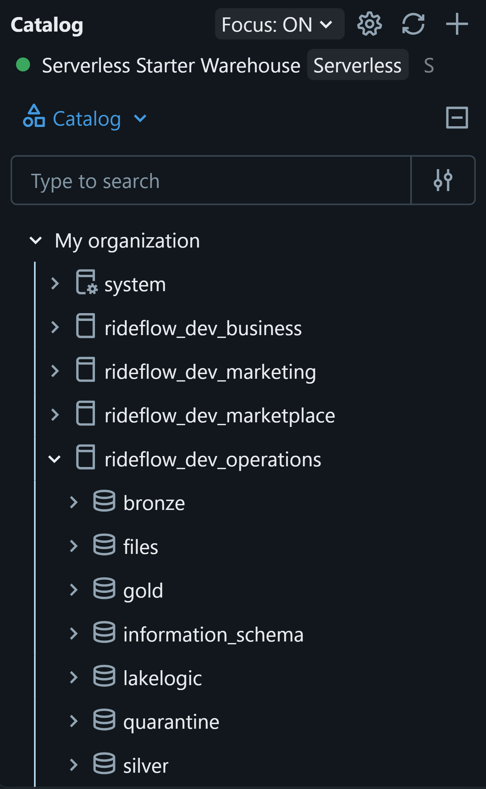
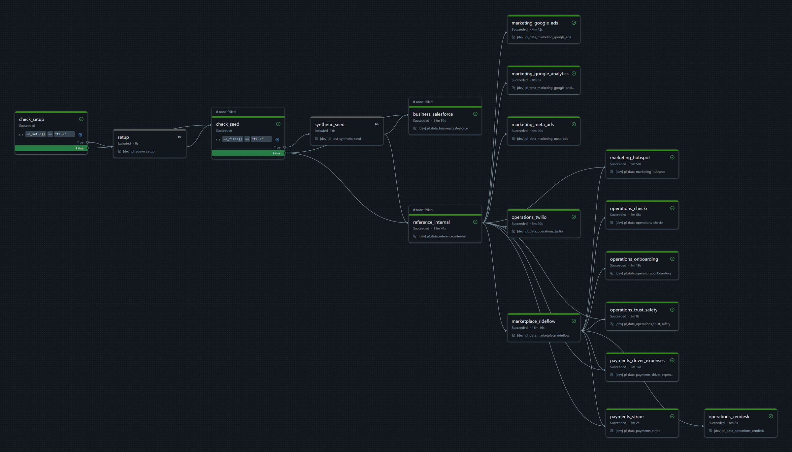
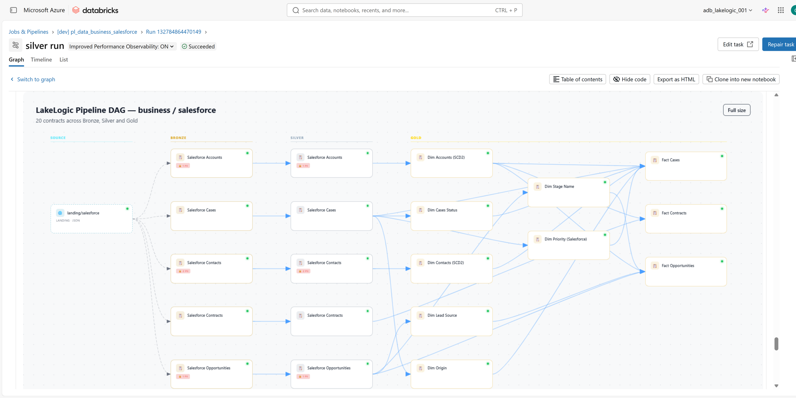

# RideFlow: a governed data mesh on Databricks

**Build a decentralised Databricks lakehouse with shared governance.**

Businesses need data they can trust, but ingestion, transformation and quality checks are often implemented differently across teams. Ownership is unclear, governance is inconsistent, and every new source adds more custom code to maintain. **LakeLogic Core standardises ingestion, transformation, validation and materialisation through executable data contracts**, giving domain teams a consistent way to deliver governed data products.

RideFlow demonstrates this in a decentralised Databricks lakehouse: CSV and JSON exports alongside PDFs, images and Word documents, processed through batch pipelines and Spark Structured Streaming.

This synthetic reference project uses **Unity Catalog, Delta Lake and Databricks Workflows**, with **158 contracts across seven domains** and Bronze, Silver and Gold layers.

## Architecture

<picture>
  <source media="(prefers-color-scheme: dark)" srcset="docs/images/rideflow_architecture_dark.png">
  
</picture>

Domains maintain their own contract trees and publish products in separate catalogs. Shared Gold products consume outputs across domain boundaries; reusable drivers and deployment tooling provide the common platform.



*RideFlow reference project · synthetic data. In Databricks after a run: one Unity Catalog catalog per domain, each with its own layer, quarantine and run-log schemas.*

**Why this is a mesh pattern:** domain-local definitions, consumer-facing products, reusable platform execution and shared governance conventions. Catalog separation and declared owners do not automatically establish team permissions; configure Unity Catalog grants and review responsibilities explicitly.

Domains: Marketplace, Payments, Operations, Marketing, Business, Reference and Shared. Some diagrams predate Business/Salesforce; the contract tree is authoritative. [Explore the architecture](docs/architecture-reference.md)

## What you can learn

| Your focus | What to inspect |
| --- | --- |
| Architecture | Domain boundaries, inherited settings and cross-domain dependencies |
| Engineering | Contract-driven ingestion, transformations, incremental processing and orchestration |
| Analytics | Gold facts, dimensions and a shared city/day marketplace-health product |
| Governance | Ownership, quality rules, privacy operations, service expectations and their evidence |
| Platform delivery | Asset Bundles, environment configuration and repository validation |

## Run the example

Use isolated demo catalogs. You need an authenticated Databricks CLI, Unity Catalog, suitable compute and setup permissions. [Prerequisites and catalog configuration](docs/catalog-configuration.md)

**Before deploying:** review [bundle variables and the dev target](platform/databricks/databricks.yml) and replace environment-specific storage locations. Cloud usage incurs costs; synthetic inputs need no live source-system credentials.

**Run independently or connect to LakeLogic Platform.** The pipelines can run without a LakeLogic Platform connection. Inspect pipeline run metadata and quality results in the LakeLogic tables within your Databricks lakehouse. If you have a LakeLogic Platform workspace, configure the telemetry endpoint and required credentials to also send run metadata to the platform for monitoring and investigation. To run independently, clear the checked-in telemetry endpoint and check secret-based overrides so no reporting destination remains configured.

```bash
cd platform/databricks
./deploy.sh dev
```

Windows PowerShell:

```powershell
Set-Location platform/databricks
.\deploy.ps1 -Target dev
```

Then run **`pl_data_00_mesh_orchestrator`** in Databricks Workflows.



*RideFlow reference project · synthetic data. The orchestrator runs each system's job in dependency order: Business and Reference first, then the systems that read them.*

**See each system's lineage.** Every pipeline run renders its DAG in the notebook with `pipeline.visualize_dag()`: source, Bronze, Silver and Gold, with personal-data counts per table. Dependencies come from each contract's `source` and `links`, so tables in the same layer run in order (Salesforce facts after the dimensions they look up).

<details>
<summary>Lineage of the Salesforce system</summary>

<picture>
  <source media="(prefers-color-scheme: dark)" srcset="docs/images/databricks_pipeline_dag_dark.png">
  
</picture>

*RideFlow reference project · synthetic data. The Salesforce silver run in Databricks, with the lineage cell fitted to width.*

</details>

**Test without live sources.** Generate synthetic inputs from Bronze contracts to test pipelines and quality checks.

**Run the mesh in order.** Included workflows coordinate systems and their Bronze, Silver and Gold stages using declared dependencies. Run the whole mesh or a single system; Shared Gold products follow their upstream systems.

**Check parameters before running or rerunning:** demo pipelines can reset selected layers, and some products overwrite their outputs. Checkpoints and seed settings also affect reruns. Do not run reset-oriented jobs against production tables.

[Manual walkthrough](docs/manual-run.md) | [Setup without the CLI](docs/no-cli-setup.md) | [Troubleshooting](docs/troubleshooting.md)

## Follow one data product

**How do trip demand, completion and revenue vary by city and day?**

Follow Marketplace requests and completed trips, join Payments charges, and inspect the Shared marketplace-health mart. Its grain is one row per `(kpi_date, city_code)`.

The [guided walkthrough](docs/data-product-walkthrough.md) links the actual contracts, explains the measure definitions, provides a SQL query and shows how to review a quality-rule change. Inspect accepted and rejected rows alongside run status, not just whether the job finished.

## Evidence and limitations


*RideFlow reference project · synthetic data. Rows held in `quarantine_silver_rideflow_driver_profiles`, each with the rule it broke and its category. Use your deployment's tables and logs to verify the revision you run.*

- Configured row failures may enter quarantine; dataset gates and execution errors can stop a run.
- Contract definitions and CI checks are distinct from successful Databricks execution. Use dated runs and output checks for the exact revision deployed.
- Synthetic tests do not establish production performance, security or business correctness. Retention and erasure jobs do not establish end-to-end GDPR compliance.
- Review permissions, realistic SLOs, recovery and operating costs before production use.

[Controls and verification details](docs/data-product-walkthrough.md#inspect-controls-and-evidence) | [Erasure workflow](docs/erasure-requests.md)

## Explore further

[Contract specification](https://github.com/LakeLogic/open-lakehouse-contract) | [LakeLogic Core runtime](https://github.com/LakeLogic/LakeLogic) | [Architecture reference](docs/architecture-reference.md)

Generation identifiers below record the original Studio export; subsequent edits are not independently attested by the hash.

<sub>Generated by LakeLogic Lakehouse Studio · revision chv1:2363087383756d2867a21c9f1cf6b32fb0a38381dc34251cc866a0f28a067fb9 · governance seal sha256:f73b1d4ee46b840f739932844b48ac4c237a543305f8673f2258a48d95d17a7c · source snap-8db66a0e80c042cd</sub>
