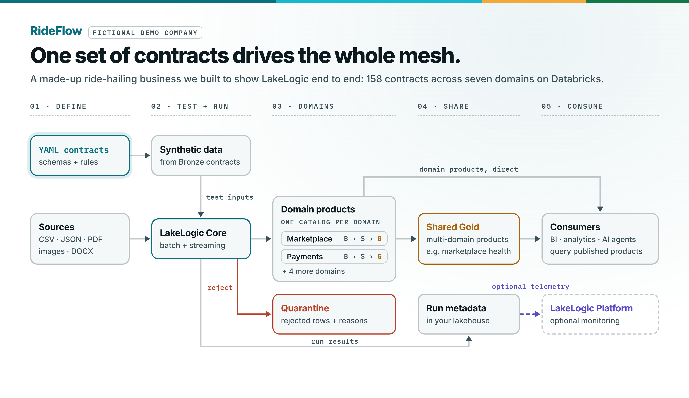

# Architecture and reference

[Back to the quickstart](../README.md)

Detailed examples and repository layout for the RideFlow reference lakehouse.

> Current inventory: 158 contracts across seven domains, including Business/Salesforce. There are 14 source-system trees plus the Shared registry. Some diagrams predate these additions; follow the README walkthrough and contract tree for the current scope.

## Reference estate

```text
RideFlow · one Databricks lakehouse (Unity Catalog) · 7 domains · 14 source systems plus Shared
Source-processing domains use the medallion pattern: Bronze (raw, all-string, schema-flexible) → Silver (typed, cleaned, transformed, validated) → Gold (products)
│
├── Marketplace   (rideflow)                          ← shown expanded as the example
│   ├── Bronze   raw · all-string · schema-flexible (evolves, keeps everything)
│   │     driver_profiles · rider_profiles · driver_telemetry · rider_app_events
│   │     trip_requests · trip_completed · trip_cancellations
│   ├── Silver   typed, cleaned, deduped, transformed, validated
│   │     driver_profiles · rider_profiles · trips (joined) · trip_requests
│   │     driver_telemetry · rider_app_events
│   └── Gold   business products
│         dim_driver · dim_rider (SCD2) · code dims (trip_type, vehicle_type, …)
│         fact_trip_completed · fact_trip_requests · fact_trip_cancellations
│         fact_driver_telemetry · fact_rider_app_events
│
├── Payments     (stripe · driver_expenses)                       →  Bronze → Silver → Gold
├── Operations   (checkr · onboarding · trust_safety · twilio · zendesk)   →  Bronze → Silver → Gold
├── Marketing    (google_ads · google_analytics · hubspot · meta_ads)      →  Bronze → Silver → Gold
├── Business     (salesforce)                                    →  Bronze → Silver → Gold
├── Reference    (internal)      →  Bronze → Silver → Gold   ·  cities, fx rates
└── Shared       (cross-domain marts)   →  Gold   ·  products that join every domain
```

<picture>
  <source media="(prefers-color-scheme: dark)" srcset="images/rideflow_architecture_dark.png">
  
</picture>

*Seven RideFlow domains publish governed data products through Unity Catalog. LakeLogic Core applies
the shared contract controls and records quarantine and run evidence.*


## How the architecture works

Source-processing domains own Bronze, Silver, and Gold definitions. Shared products consume other domains' outputs directly. Shared
settings can be inherited from `_domain.yaml` and `_system.yaml`; individual
contracts keep dataset-specific rules beside the team that understands the data.

The repository contains 158 contracts across Marketplace, Marketing, Payments,
Operations, Business, Reference, and Shared. The examples include CSV, JSON, unstructured
PDF input, external Python logic, cross-domain Gold products, row-level lineage
tags, freshness and volume SLOs, and an engine-agnostic pipeline DAG.

### Medallion plus quarantine


*Contracts govern every layer. Row failures can enter quarantine while valid rows
continue; dataset gates can still stop an unsafe run.*

Quarantine is a failure path, not another medallion layer. A rejected row retains
the failed rule and source context. Structured run logs record what passed, what
failed, and how long each contract took.

### Dependency-aware execution

Contracts declare `depends_on` edges. LakeLogic builds the directed acyclic graph
and processes products in dependency order, including dependencies within the
same medallion layer.


### Cross-domain products

Shared Gold products can consume products owned by other domains. Their declared
dependencies preserve lineage across team boundaries.


*The shared revenue and driver products depend on data owned by Payments,
Marketplace, and Operations.*

### SCD Type 2

Gold contracts can declare SCD Type 2 materialization, including tracked columns,
surrogate keys, effective dates, current-version flags, and an unknown member.


## What gets created

```text
One catalog per domain: rideflow_dev_<domain>
├── files                Volumes: `landing` (inbound source files) and `lakelogic_logs` (run logs)
├── bronze               Bronze Delta tables
├── silver               Silver Delta tables
├── gold                 Gold Delta tables
├── quarantine           Contract-failing rows
└── lakelogic            Run log, SLO results, retention and erasure evidence

Domains: marketplace, marketing, payments, operations, business,
         reference (shared lookups and conformed dimensions),
         shared (cross-domain marts; gold only)
```

There is no separate platform catalog. Each `_system.yaml` sets its own table,
landing and log locations. The jobs read contracts from the workspace files the
bundle syncs, at `${workspace.file_path}/contracts`.

## Repository layout

The repository keeps reusable data-product definitions separate from the code
that deploys and runs them on Databricks:

```text
.github/
  workflows/validate.yml      CI validation for contracts and Python files
contracts/             Domain-owned contract trees
  business/                   Salesforce
  marketing/                  Google Ads, Google Analytics, HubSpot, and Meta Ads
    <system>/
      _system.yaml             System defaults and contract registry
      contracts/
        bronze/                Source-aligned ingestion contracts
        silver/                Cleaned and conformed data products
        gold/                  Business-facing facts, dimensions, and aggregates
  marketplace/                Trips, riders, drivers, telemetry, and pricing
  operations/                 Checkr, onboarding, trust and safety, Twilio, and Zendesk
  payments/                   Stripe and driver expenses
  reference/                  Shared lookups and conformed reference data
  shared/                     Cross-domain products and marts
platform/databricks/
  databricks.yml              Asset Bundle variables, sync paths and targets
  deploy.ps1 / deploy.sh      Windows and Unix deployment wrappers
  notebooks/
    nb_00_setup.py            Catalog, schema and Volume setup from the registries
    nb_pipeline_driver.py     Registry-driven Bronze, Silver, and Gold runner
    nb_test_data_driver.py    Synthetic landing-data generator
    nb_slo_checks.py          Service-level (freshness / row-count) checks
    nb_maintenance_optimize.py  Delta OPTIMIZE + VACUUM
    nb_compliance_retention_check.py  Read-only retention check
    nb_compliance_erasure.py  Data-subject erasure tooling, dry run by default
  resources/                  Jobs, grouped as LakeLogic Build Centre renders them
    admin/                    pl_admin_setup, pl_admin_maintenance
    data/                     pl_data_00_mesh_orchestrator (setup, seed, then every system),
                              pl_data_<domain>_<system> (bronze, silver and gold tasks)
    monitor/                  pl_monitor_slo
    privacy/                  pl_privacy_retention, pl_privacy_erasure
    test/                     pl_test_synthetic_seed (every system that ingests files)
  tests/                      Bundle structure tests
docs/                         Alternative setup and troubleshooting guides
  images/                     README screenshots and architecture diagrams
platform/reports/             Power BI reports and semantic models
platform/scripts/
  validate_release.py         Static checks used locally and in CI
README.md                     Public overview and quickstart
LICENSE                       Apache 2.0 licence
```

`contracts/` contains the portable business definitions. `platform/databricks/`
contains the platform-specific deployment and execution code. This boundary is
intentional: a domain team can review its contracts without needing to understand
the complete Asset Bundle, while the platform team can change deployment code
without moving business rules into notebooks.
