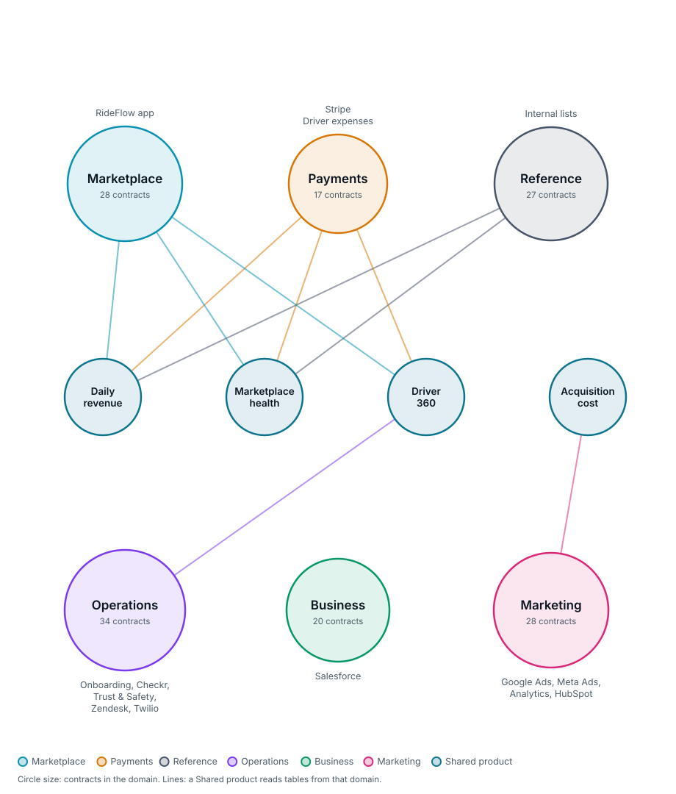
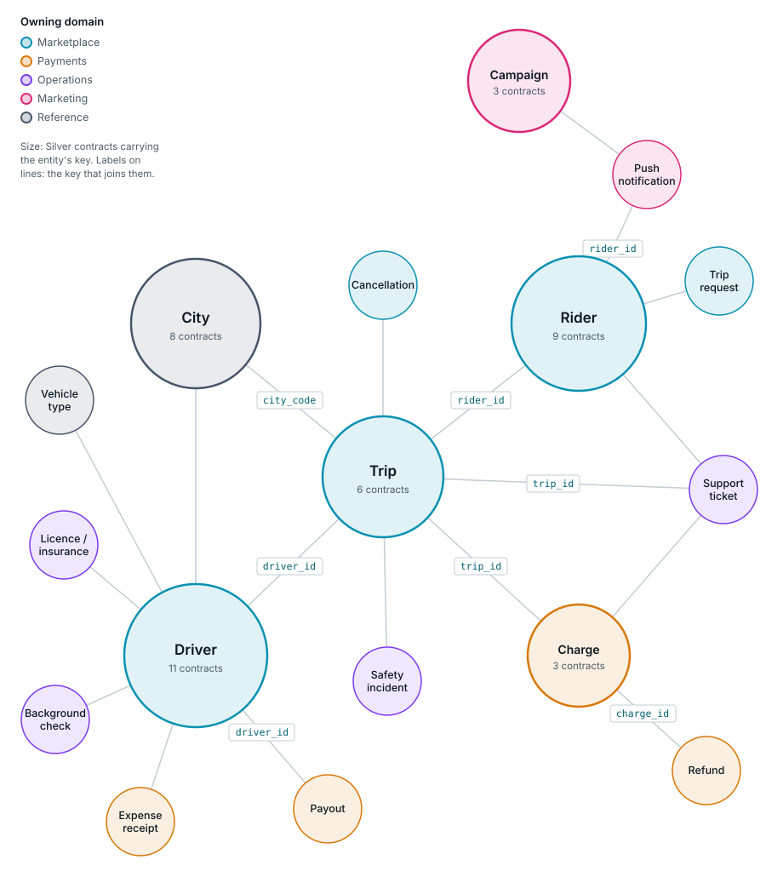

# RideFlow: the business case

[Back to the README](../README.md)

RideFlow is a fictional ride-hailing company. Riders book trips in the app, drivers accept them, Stripe takes the payment and pays the driver, and a support team handles anything that goes wrong. Every number in this repository is synthetic.

This page explains the business behind the reference project: who owns which data, how the systems connect, and one story you can walk someone through in about ten minutes.

## The problem

RideFlow grew city by city. Each team bought or built its own tools, and each tool exports data in its own way.

- **Finance** reports revenue from Stripe. **Operations** reports trips from the app. On a bad week the two numbers do not agree, and nobody can say which is right.
- A rule like "a refund can never exceed the charge" lives in someone's head or in one notebook, not anywhere the next engineer will find it.
- When a feed is late, dashboards still show yesterday's figure with today's date on it.
- Driver documents (licences, background checks, expense receipts) arrive as PDFs and photos. They hold personal data and are not governed like tables.

The goal is not one central team doing everything. Each domain keeps owning its data; the platform gives every team the same way to describe, check and publish it.

## Who owns what

| Domain | Owner | Systems | What they send |
| --- | --- | --- | --- |
| Marketplace | Platform Data Engineering | RideFlow app | Trip requests and driver telemetry as streams; trips, cancellations, rider and driver profiles as CSV and JSON |
| Payments | Finance Engineering | Stripe, driver expenses | Charges, refunds and payouts as CSV; expense receipts as images |
| Operations | Operations | Onboarding, Checkr, Trust & Safety, Zendesk, Twilio | Driver documents as PDFs and images, incident reports as Word files, background checks, support tickets and SMS logs as CSV |
| Marketing | Marketing | Google Ads, Meta Ads, Google Analytics, HubSpot | Campaign spend, app sessions, email and push results as CSV |
| Business | Sales | Salesforce | Accounts, contacts, opportunities, contracts and cases as JSON |
| Reference | Platform Data Engineering | Internal | Cities, vehicle types, dates and other shared lists as CSV |
| Shared | Platform Data Engineering, for Finance and Operations consumers | — | Cross-domain products built from the others |

Ownership is declared in each domain's `_domain.yaml`, with a contact and alert channel, so a failed check reaches the team that can fix it.

## How the systems connect

<picture>
  <source media="(prefers-color-scheme: dark)" srcset="images/rideflow_systems_dark.svg">
  
</picture>

*Each domain circle is sized by its number of contracts. Lines show which domains each Shared product reads from, taken from the table paths in its contract. Business (Salesforce) feeds no Shared product yet.*

Three keys hold the estate together:

- **`trip_id`** links a Stripe charge to the trip it paid for. That join is how revenue gets a city and a vehicle type.
- **`driver_id`** links trips, payouts, background checks and onboarding documents into one view of a driver.
- **`city_code`** links everything to the Reference city list, so "London" means the same row on every report.

Each system lands its files in its own folder, moves through Bronze (as received), Silver (cleaned, checked, de-duplicated) and Gold (facts and dimensions), and publishes into its own Unity Catalog catalog. The four Shared products read across catalogs and run only after the systems they depend on.

## Business ontology

The systems above are where data comes from. The business map is what the business talks about: RideFlow's main concepts, their owners and the data contracts that hold them. The concepts and relationships are curated by hand; the identifier counts come from the contracts. Missing links are questions for the owning teams.

<picture>
  <source media="(prefers-color-scheme: dark)" srcset="images/rideflow_ontology_dark.svg">
  
</picture>

*Circle size is how many Silver contracts contain the concept's identifier: `driver_id` appears in 11, `rider_id` in 9, `city_code` in 8, `trip_id` in 6. A shared column name is a hint, not proof of a valid join or of the same meaning; each relationship below says how it joins and whether a person has confirmed it. Colour is the owning domain; labels on lines name the joining key.*

### Core entities

The **identifier** is the entity's own key. The **canonical contract** is the LakeLogic contract that holds the cleaned record; the **source system** is where it originates.

| Entity | Meaning | Identifier | Owner | Source system | Canonical contract |
| --- | --- | --- | --- | --- | --- |
| Rider | A person who books trips | `rider_id` | Marketplace | RideFlow app | [`silver_rideflow_rider_profiles`](../contracts/marketplace/rideflow/contracts/silver/silver_rideflow_rider_profiles.yaml) |
| Driver | A person approved to drive, with a home city and vehicle type | `driver_id` | Marketplace | RideFlow app | [`silver_rideflow_driver_profiles`](../contracts/marketplace/rideflow/contracts/silver/silver_rideflow_driver_profiles.yaml) |
| Trip request | A rider asking for a ride; may never become a trip | request key | Marketplace | RideFlow app | [`silver_rideflow_trip_requests`](../contracts/marketplace/rideflow/contracts/silver/silver_rideflow_trip_requests.yaml) |
| Trip | A completed ride by one driver for one rider | `trip_id` | Marketplace | RideFlow app | [`silver_rideflow_trip_completed`](../contracts/marketplace/rideflow/contracts/silver/silver_rideflow_trip_completed.yaml) |
| Cancellation | A trip that ended before completion, with a reason | `trip_id` | Marketplace | RideFlow app | [`silver_rideflow_trip_cancellations`](../contracts/marketplace/rideflow/contracts/silver/silver_rideflow_trip_cancellations.yaml) |
| Charge | Money taken from a rider for a trip | `charge_id` | Payments | Stripe | [`silver_stripe_charges`](../contracts/payments/stripe/contracts/silver/silver_stripe_charges.yaml) |
| Refund | Money returned against a charge | `refund_id` | Payments | Stripe | [`silver_stripe_refunds`](../contracts/payments/stripe/contracts/silver/silver_stripe_refunds.yaml) |
| Payout | Money paid to a driver | `payout_id` | Payments | Stripe | [`silver_stripe_payouts`](../contracts/payments/stripe/contracts/silver/silver_stripe_payouts.yaml) |
| Expense receipt | A driver's expense claim, read from a photo | receipt key | Payments | Driver expenses | [`silver_driver_expenses_receipts`](../contracts/payments/driver_expenses/contracts/silver/silver_driver_expenses_receipts.yaml) |
| Background check | A Checkr screening result for a driver | check key | Operations | Checkr | [`silver_checkr_background_checks`](../contracts/operations/checkr/contracts/silver/silver_checkr_background_checks.yaml) |
| Driver document | A driving licence or insurance certificate, read from a PDF or image | document key | Operations | Onboarding | [`onboarding`](../contracts/operations/onboarding/contracts/silver/) |
| Safety incident | A Trust & Safety report about a driver or trip | incident key | Operations | Trust & Safety | [`silver_trust_safety_incident_reports`](../contracts/operations/trust_safety/contracts/silver/silver_trust_safety_incident_reports.yaml) |
| Support ticket | A Zendesk ticket about a rider, driver, trip or charge | ticket key | Operations | Zendesk | [`silver_zendesk_support_tickets`](../contracts/operations/zendesk/contracts/silver/silver_zendesk_support_tickets.yaml) |
| Campaign | A paid or owned marketing campaign | `campaign_id` | Marketing | Google Ads, Meta Ads, HubSpot | Google Ads, Meta Ads, HubSpot Silver contracts |
| City | A market RideFlow operates in | `city_code` | Reference | Internal | [`gold_dim_city_master`](../contracts/reference/internal/contracts/gold/gold_dim_city_master.yaml) |
| Vehicle type | The class of car a driver operates | vehicle type code | Reference | Internal | [`gold_dim_vehicle_type`](../contracts/reference/internal/contracts/gold/gold_dim_vehicle_type.yaml) |

### Relationships

Each relationship is a business sentence with the keys that join it. None is confirmed yet by the owning teams; confirming one records it in that domain's `_domain.yaml`.

| Relationship | Joins on | Expected cardinality | Status |
| --- | --- | --- | --- |
| Rider books Trip | `rider_id` | one rider, many trips | curated |
| Driver completes Trip | `driver_id` | one driver, many trips | curated |
| Trip happens in City | `city_code` | one city, many trips | curated |
| Charge pays for Trip | `trip_id` | one trip, at most one charge | curated |
| Refund reverses part of Charge | `charge_id` | one charge, many refunds | curated |
| Payout pays Driver | `driver_id` | one driver, many payouts; not linked to trips | curated |

### Shared vocabulary

These are the terms reports use. Each is defined once, in the contract named, so a word means the same thing on every dashboard.

| Term | Definition | Defined in |
| --- | --- | --- |
| Gross revenue | Sum of **succeeded** charges for completed trips, by the day the charge was created, in GBP | `gold_fact_revenue_daily` |
| Net revenue | Gross revenue minus **succeeded** refunds on those charges, in GBP | `gold_fact_revenue_daily` |
| Driver payouts | **Paid** payouts by arrival day, attributed to the driver's home city and vehicle type; not matched to individual trips | `gold_fact_revenue_daily` |
| Platform commission | RideFlow's take: 25% of gross revenue | `gold_fact_revenue_daily` |
| Requested trips, completed trips, cancellation rate | Activity by city and request date | `gold_mart_marketplace_health` |
| Acquisition cost | Ad spend divided by attributed new riders, per day, channel and campaign | `gold_mart_acquisition_cost` |

### Where the ontology has gaps

An honest ontology shows what is *not* connected:

- **Salesforce accounts and cases** carry no rider, driver or trip key, so business customers cannot yet be joined to the trips they paid for.
- **Ad campaigns** link to riders only through push notifications; there is no click-to-signup key, so acquisition cost is an aggregate, not per rider.
- **Twilio SMS logs** carry no rider or driver key in Silver.

Each gap is a question for the owning team, not a fix the platform can make alone.

## The story: "Why doesn't revenue match Stripe?"

Use this when you have ten minutes and one person from finance or data in the room. Every step points at a real file in this repository.

### 1. The question

Finance's Monday report shows net revenue by city. The finance lead asks the question every data team has heard: *"Where does this number come from, and why should I trust it?"*

Open [`gold_fact_revenue_daily`](../contracts/shared/shared/contracts/gold/gold_fact_revenue_daily.yaml). The answer is written down, not tribal: gross revenue is the sum of succeeded Stripe charges, joined to completed trips by `trip_id`; net revenue is gross minus succeeded refunds; one row per day, city and vehicle type, in GBP. Every amount is converted with that day's rate from `gold_fact_fx_rates_daily`; an amount with no rate is left out and counted in `unconverted_count`, never guessed.

### 2. Who owns the inputs

The charges come from Payments. Open [`payments/_domain.yaml`](../contracts/payments/_domain.yaml): the owner is Finance Engineering, with a named contact and alert channels. Trips come from Marketplace, owned by Platform Data Engineering. The revenue product itself sits in Shared: Platform Data Engineering builds and runs it, and Finance is the accountable business owner who signs off what "revenue" means.

*Talking point:* when the number is wrong, you know who to call before you open a notebook.

### 3. What gets checked before a charge counts

Open [`silver_stripe_charges`](../contracts/payments/stripe/contracts/silver/silver_stripe_charges.yaml):

- **`charge_id` is the primary key**, so a payment exported twice is counted once.
- **Amounts must be between 0 and 1,000,000**, and every charge needs a rider and a timestamp.
- **Currency must be one of eight listed codes.** A charge in any other currency is held back rather than counted.

Rows that fail go to a quarantine table with the rule they broke, and the clean rows carry on. Show the quarantine screenshot in the README: each held row names its rule.

### 4. The rules on the answer itself

Back in the revenue contract, the output has its own checks:

- `refund_le_gross`: refunds for a day can never exceed that day's gross revenue.
- `net_revenue_non_negative`: net revenue never goes below zero.

*Talking point:* the input checks catch bad rows; these catch a bad join or a bad calculation. A row that breaks them is quarantined, not published.

### 5. When the data is late

Payments promises Bronze within two hours and Silver within five (`slo.freshness` in `payments/_domain.yaml`). If Stripe's export stops, the service-level check breaches and alerts Finance Engineering, instead of the dashboard quietly showing stale revenue.

### 6. Change it safely

Finance wants to accept a new currency. That is a one-line change to the accepted-values rule in the Silver charges contract, made on a branch and reviewed in a pull request like any code change. The [walkthrough](data-product-walkthrough.md#try-a-reviewed-change) shows the steps.

### The close

Revenue is no longer a number someone produced. It has an owner, a written definition, checks on its inputs and on itself, a freshness promise, and a review process for changing any of them, and every team in the estate uses the same pattern.

## Other stories in the same estate

- **Driver 360.** One driver's profile, payouts and background checks in one view, joined across Marketplace, Payments and Operations, with personal data classified at the source and an [erasure workflow](erasure-requests.md) that covers it.
- **Marketplace health.** Requests, completions, cancellation rate and revenue by city and day. The [walkthrough](data-product-walkthrough.md) follows it end to end.
- **Acquisition cost.** Spend from Google Ads, Meta Ads and HubSpot campaigns against attributed new riders, per day, channel and campaign.

## What this is not

RideFlow is a reference project with synthetic data. It shows the pattern; it does not prove production performance, financial accuracy or regulatory compliance. Confirm business definitions, currencies, permissions and service levels with the real owners before relying on any of it.

The diagrams on this page are generated from the contracts by [`scripts/render_business_case_diagrams.py`](../scripts/render_business_case_diagrams.py). Re-run it after changing contracts.
