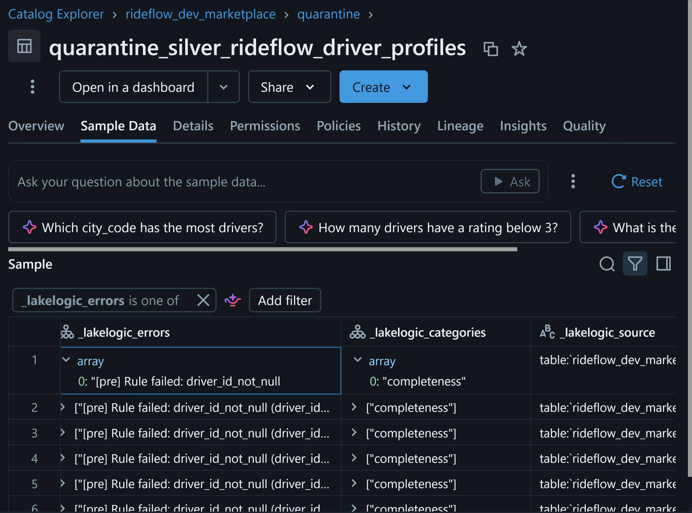

# Follow a cross-domain data product

[Back to the README](../README.md)

## Follow one data product

**Business question: how do trip demand, completion and revenue vary by city and day?**

The Shared marketplace-health mart combines Marketplace activity with Payments charges. Domain teams retain their source definitions; the Shared contract defines the combined product.

| Step | Inspect | Learn |
| --- | --- | --- |
| Ingestion | [Marketplace registry](../contracts/marketplace/rideflow/_system.yaml) | Contract selection, bindings and environment settings |
| Clean requests | [Silver trip requests](../contracts/marketplace/rideflow/contracts/silver/silver_rideflow_trip_requests.yaml) | Field checks, request-key deduplication and Delta streaming with `available_now` |
| Payment data | [Silver charges](../contracts/payments/stripe/contracts/silver/silver_stripe_charges.yaml) | A separately owned schema, quality checks and incremental configuration |
| Shared output | [Marketplace-health mart](../contracts/shared/shared/contracts/gold/gold_mart_marketplace_health.yaml) | Cross-catalog links, aggregation, consistency rules and full-refresh overwrite |

`available_now` processes currently available input; it does not mean a continuously running stream. Read the mart SQL and `links` together: the output grain is **one row per `(kpi_date, city_code)`**, activity is attributed using request dates, and revenue uses charges joined to completed trips. Confirm currency and business definitions before using this as financial reporting.

### Query the result

After a successful run, check the resolved catalog and schema. With default naming:

```sql
SELECT kpi_date, city_code, requested_trips, completed_trips,
       cancellation_rate, gross_revenue_amount
FROM rideflow_dev_shared.gold.gold_mart_marketplace_health
ORDER BY kpi_date DESC, city_code
LIMIT 20;
```

Adjust identifiers for your deployment. A successful query or green workflow alone does not establish correctness: inspect measures, row counts and rule outcomes.

### Try a reviewed change

1. Create a branch and inspect `trip_type_accepted_values` in the Silver request contract.
2. Propose an accepted-value change and identify affected synthetic rows.
3. Run configured validation, then execute the affected pipeline in isolated demo catalogs.
4. Compare accepted rows, quarantine and run status before and after. Review before merging.

A quality-rule change is not necessarily a breaking schema change. Inspect [CI](../.github/workflows/validate.yml) and installed PR checks to see which assessments actually ran.

## Inspect controls and evidence

| Control | Definition | Evidence after execution |
| --- | --- | --- |
| Row quality | Allowed values, ranges and required identifiers in contracts | Accepted/rejected counts and reasons |
| Shared-product consistency | Mart rules such as `requested_ge_completed` | Actual rule outcomes and rejected output |
| Ownership and inherited policies | Domain/system/contract metadata | Resolved settings and review records; not implied access grants |
| Service expectations | Domain SLOs and monitoring jobs | Evaluated timestamps, thresholds and monitoring output |
| Privacy operations | [Erasure workflow](erasure-requests.md), retention jobs and settings | Request handling and execution evidence for the configured scope |



*Illustrative evidence from an earlier run; inspect your own resolved table schema and results.*

Configured row failures may enter quarantine while valid rows continue. Dataset gates, parsing errors or runtime failures can stop a run. Reconciliation must distinguish rejected rows from intentional deduplication, filtering and aggregation; counts need not remain equal across transformations.

## Adapt the pattern

Start with one source and one consumer-facing product. Review its `_system.yaml`, contract tree and inherited defaults. Replace synthetic bindings with approved locations and runtime-managed secrets. Agree grain, owner, consumers, quality and service expectations. Review new dependencies, permissions and orchestration, then verify behaviour on the target platform.

## Verification and operating boundaries

- **Defined:** contracts, notebooks, jobs and CI are inspectable in the repository.
- **Validated:** use check results for your exact revision; structural checks do not execute Databricks workloads.
- **Runtime verified:** use dated runs and output checks for the revision and environment deployed. Screenshots do not certify the current checkout.
- Synthetic tests do not prove production performance, resilience, regulatory compliance or business correctness.
- Retention and erasure jobs support configured operations, not end-to-end GDPR compliance across sources, exports and backups.
- Review costs, checkpoints, schema evolution, recovery, permissions, maintenance and exit before production use. Demo SLO thresholds may be deliberately permissive.

